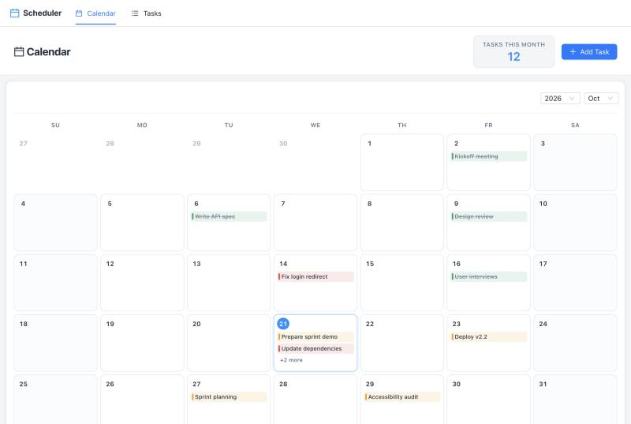
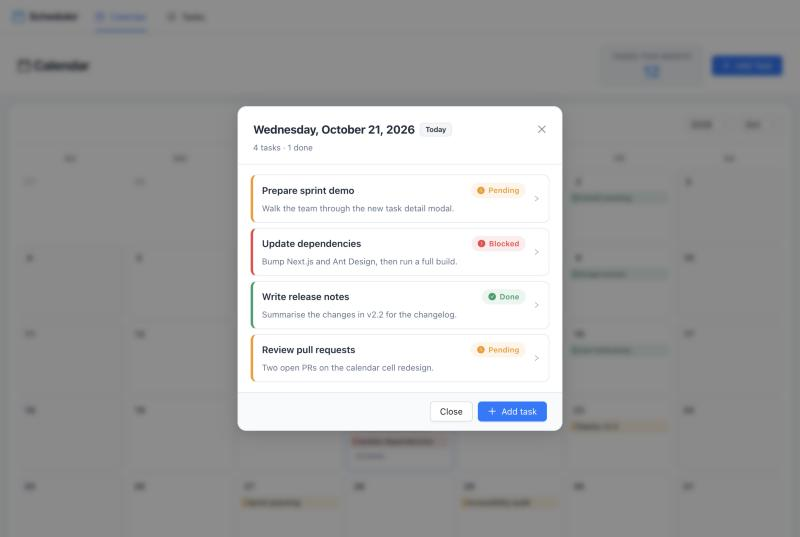
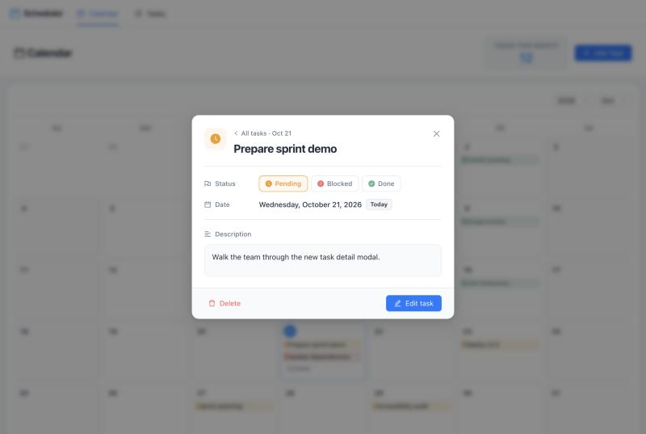
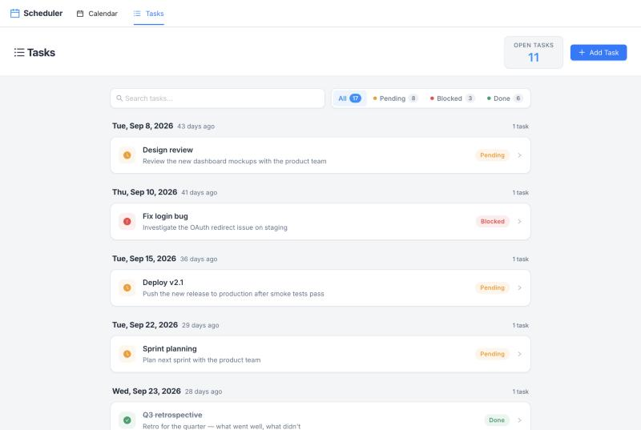

# Scheduler — Calendar & Task Planner

A calendar-first task planner built with Next.js 15, React 18 and Ant Design 5. Plan tasks on a monthly calendar, open any day to see everything scheduled for it, and track each task as **Pending**, **Blocked** or **Done**. Everything is stored in the browser, so it works without a backend or an account.




## Contents

- [Features](#features)
- [Screenshots](#screenshots)
- [Tech stack](#tech-stack)
- [Getting started](#getting-started)
- [Available scripts](#available-scripts)
- [How to use](#how-to-use)
- [Task statuses](#task-statuses)
- [Data and storage](#data-and-storage)
- [Project structure](#project-structure)
- [Architecture notes](#architecture-notes)
- [Continuous integration](#continuous-integration)
- [Known limitations](#known-limitations)
- [Contributing](#contributing)
- [License](#license)

## Features

**Calendar (`/calender`, also the home page)**
- Monthly view where each task appears as a bar in its status color; completed tasks are struck through.
- A day shows up to three tasks; busier days show two and a **+N more** link.
- Today is marked with a filled blue date.
- Hover a day to reveal a **+** button that adds a task to that day.
- On phones, each day shows one colored dot per task instead of the task titles.

**Day view**
- Click a day (or one of its tasks, or **+N more**) to open a list of every task on that day, with title, status and description.
- Add a new task for that day from the same window.

**Task details**
- Status, date and description in one view.
- Change the status with a single click; it saves immediately.
- Edit the task, or delete it after a confirmation.
- When opened from the day view, a back link returns you to that day's list.

**Tasks page (`/tasks`)**
- All tasks grouped by date, with friendly labels such as *Today*, *Tomorrow* or *43 days ago*.
- Search by title or description.
- Filter by status, with a live count for each status.
- Header shows the number of open tasks (Pending + Blocked).

**General**
- Tasks persist in `localStorage`, so they survive page reloads.
- Responsive layout for desktop, tablet and mobile.

## Screenshots

| Day view | Task details | Tasks page |
| --- | --- | --- |
|  |  |  |

## Tech stack

| Area | Library | Version |
| --- | --- | --- |
| Framework | [Next.js](https://nextjs.org/) (App Router) | 15 |
| UI | [React](https://react.dev/) | 18 |
| Components | [Ant Design](https://ant.design/) + `@ant-design/icons` | 5 |
| State | [Zustand](https://zustand.docs.pmnd.rs/) with the `persist` middleware | 5 |
| Data fetching | [TanStack Query](https://tanstack.com/query) + [Axios](https://axios-http.com/) | 5 / 1 |
| Language | [TypeScript](https://www.typescriptlang.org/) | 5 |
| Styling | Plain CSS with design tokens (Tailwind is configured but its utility classes are not used) | — |
| Linting | ESLint with `eslint-config-next` | 8 |

## Getting started

### Prerequisites

- **Node.js 18.18 or newer** (required by Next.js 15; developed on Node 22)
- **npm** (a `package-lock.json` is committed)

### Installation

```bash
git clone https://github.com/sqr-mth/calender-schadule.git
cd calender-schadule
npm install
npm run dev
```

Then open [http://localhost:8080](http://localhost:8080). The dev server always uses port **8080**.

### Production build

```bash
npm run build
npm start
```

`npm start` serves the production build on port 8080.

## Available scripts

| Command | What it does |
| --- | --- |
| `npm run dev` | Start the development server with hot reload on port 8080 |
| `npm run build` | Create an optimized production build in `.next/` |
| `npm start` | Serve the production build on port 8080 |
| `npm run lint` | Run ESLint using the Next.js rules |

## How to use

| I want to… | Do this |
| --- | --- |
| Add a task for today | Click **Add Task** in the page header (Calendar or Tasks page) |
| Add a task on a specific day | Click an empty day, or hover a day and click its **+** button |
| See all tasks on a day | Click the day, one of its tasks, or **+N more** |
| Open a task | Click it in the day view or on the Tasks page |
| Change a task's status | Open the task and click **Pending**, **Blocked** or **Done** |
| Edit a task | Open the task and click **Edit task** |
| Delete a task | Open the task, click **Delete**, then confirm |
| Find a task | Go to **Tasks**, then search or filter by status |

## Task statuses

| Value | Label | Color | Meaning |
| --- | --- | --- | --- |
| `1` | Pending | Amber `#f59e0b` | Not started or in progress |
| `2` | Blocked | Red `#ef4444` | Waiting on something else |
| `3` | Done | Green `#22a06b` | Finished (shown struck through) |

Status values, colors and icons are defined in [`src/components/Calender/taskMeta.tsx`](src/components/Calender/taskMeta.tsx); labels come from [`src/state/tasks.ts`](src/state/tasks.ts).

## Data and storage

### Task model

```ts
interface Task {
  id: string;        // unique id (a timestamp for tasks created in the app)
  title: string;
  desc: string;      // description
  date: string;      // "YYYY-MM-DD"
  status?: 1 | 2 | 3;
}
```

### Where tasks are stored

Tasks live in a [Zustand](https://zustand.docs.pmnd.rs/) store ([`src/state/tasks.ts`](src/state/tasks.ts)) that is persisted to `localStorage` under the key **`scheduler-tasks-v2`**. Data is per browser and per device; nothing is sent to a server.

To start over, run this in the browser console and reload the page:

```js
localStorage.removeItem("scheduler-tasks-v2");
```

### Sample data

`GET /api` ([`src/app/(pages)/api/route.ts`](src/app/%28pages%29/api/route.ts)) returns five sample tasks dated September 2026. On load, both pages fetch it with TanStack Query and add any sample task whose `id` is not already in the store.

## Project structure

```
calender-schadule/
├── .github/
│   ├── ISSUE_TEMPLATE/          # Bug report and feature request templates
│   └── workflows/ci.yml         # Lint + build on push and pull requests
├── docs/screenshots/            # Images used in this README
├── public/                      # Static assets
├── src/
│   ├── app/
│   │   ├── layout.tsx           # Root layout: font, providers, nav
│   │   ├── providers.tsx        # TanStack Query client
│   │   ├── globals.css          # Design tokens, nav, page header, Tasks page styles
│   │   └── (pages)/
│   │       ├── page.tsx         # "/"          → calendar
│   │       ├── calender/page.tsx# "/calender"  → calendar
│   │       ├── tasks/page.tsx   # "/tasks"     → task list
│   │       └── api/route.ts     # "/api"       → sample tasks (GET)
│   ├── components/
│   │   ├── Nav.tsx              # Top navigation
│   │   ├── Tasks.tsx            # Tasks page: search, filters, grouped list
│   │   ├── RadioGroup/          # Radio group component (currently unused)
│   │   └── Calender/
│   │       ├── Calendar.tsx     # Calendar page and custom day cells
│   │       ├── DayTasksModal.tsx# List of tasks for one day
│   │       ├── TaskDetailModal.tsx # Task details, quick status, edit, delete
│   │       ├── TaskFormModal.tsx   # Add / edit modal (shared by both pages)
│   │       ├── FormCalender.tsx # Form fields used by TaskFormModal
│   │       ├── taskMeta.tsx     # Status colors/icons and date helpers
│   │       ├── style.css        # Calendar grid and day cells
│   │       └── modals.css       # Modal and form styles
│   └── state/
│       └── tasks.ts             # Zustand store, Task type, status labels
├── next.config.mjs
├── tailwind.config.ts
└── tsconfig.json
```

## Architecture notes

- **Client-side rendering.** The Calendar and Tasks components are loaded with `next/dynamic` and `ssr: false`, because their data comes from `localStorage`, which only exists in the browser.
- **One source of truth.** Both pages read and write the same Zustand store, so a change on one page shows up on the other immediately.
- **Shared modals.** The task detail and add/edit modals are the same components on both pages, so they look and behave identically.
- **Custom calendar cells.** Day cells are rendered with Ant Design's `fullCellRender`, which gives full control over the layout instead of styling around the default cell.
- **Local dates.** "Today" is computed in the user's local time zone (`todayISO()` in `taskMeta.tsx`), not UTC.
- **Styling.** Colors, radii and shadows are CSS variables defined in `globals.css` (`--c-primary`, `--c-border`, …). The app uses a light theme only.

## Continuous integration

[`.github/workflows/ci.yml`](.github/workflows/ci.yml) runs `npm ci`, `npm run lint` and `npm run build` on Node.js 22 and 24 for every push and pull request to `main`. There are no automated tests yet.

## Known limitations

- **No sync.** Tasks are stored only in the current browser; clearing site data deletes them, and they don't sync between devices.
- **Sample tasks come back.** Deleting one of the five sample tasks only lasts until the next reload, because the sample data is merged back in by `id`.
- **No tests.** There is no unit or end-to-end test suite yet.
- **Light theme only.** There is no dark mode.
- **Route spelling.** The calendar route is `/calender` (the home page `/` shows the same view).

## Contributing

Contributions are welcome. Please read [CONTRIBUTING.md](CONTRIBUTING.md) for the workflow, and use the [issue templates](.github/ISSUE_TEMPLATE) to report bugs or suggest features. Before opening a pull request, make sure `npm run lint` and `npm run build` pass.

## License

Released under the [MIT License](LICENSE).
